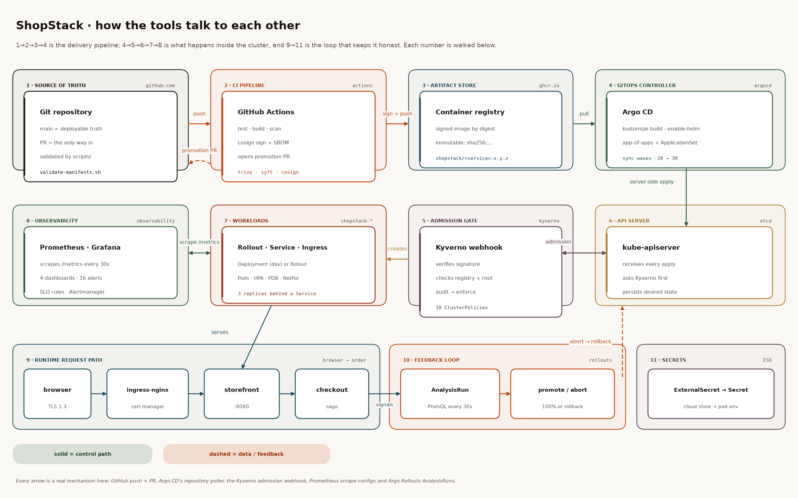
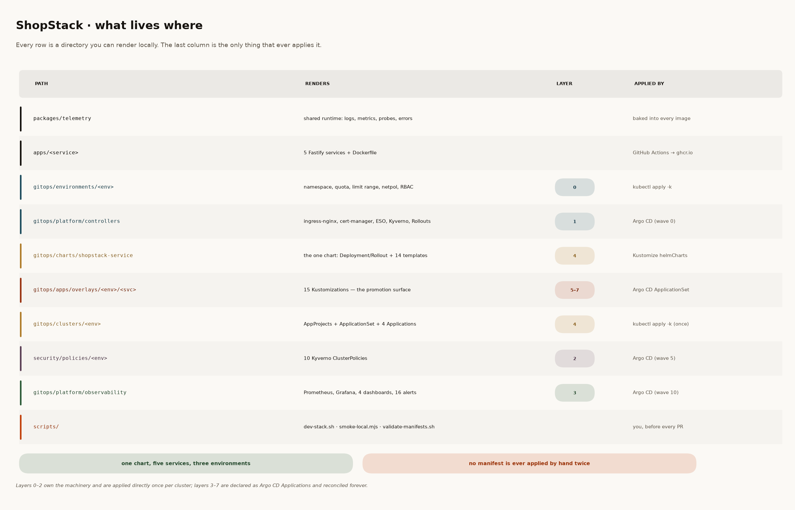
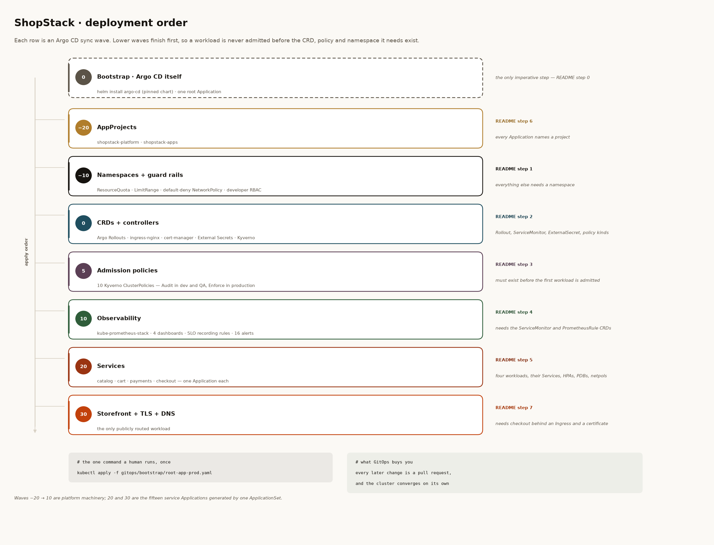
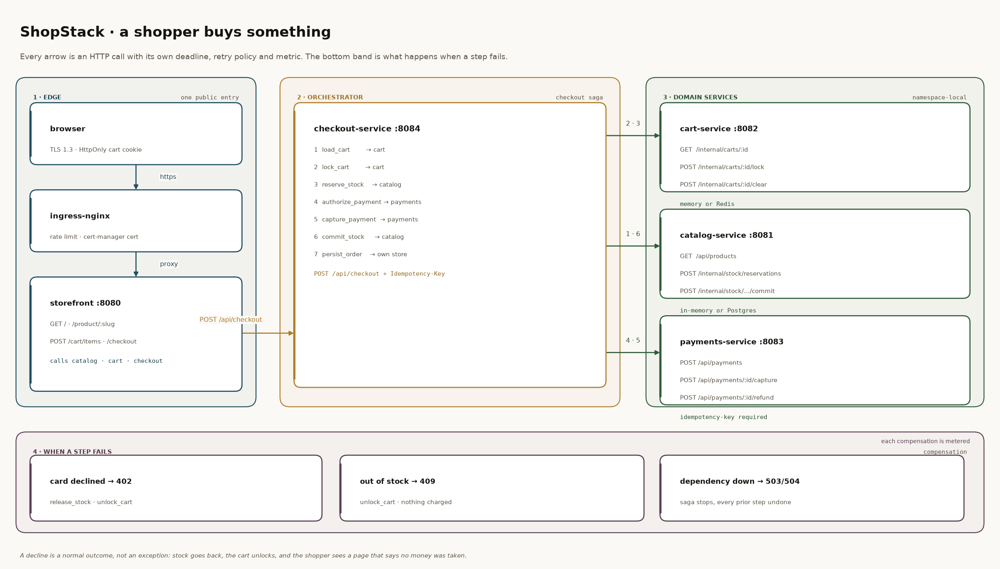
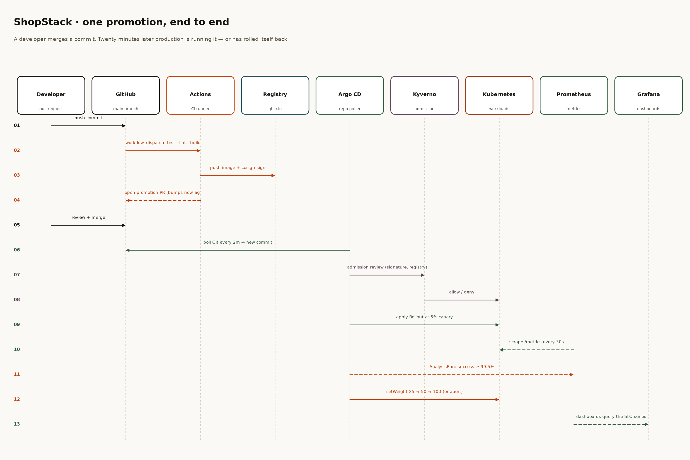

# ShopStack

**A production-shaped e-commerce platform, delivered entirely from Git.**

Five Node.js services, one Helm chart, three environments and a delivery pipeline in
which the only way to change a cluster is a reviewed commit. Argo CD reconciles the
cluster, Kustomize composes the per-environment intent, Argo Rollouts shifts traffic in
canary steps, Kyverno refuses anything that is not signed and hardened, and Prometheus
decides whether a rollout keeps going.

Nothing in here is a diagram of an idea. Every command in this README was run against
this repository, and every number in the table below is reproducible with the command
next to it.

| Gate             | Command                                   | Result                                                       |
| ---------------- | ----------------------------------------- | ------------------------------------------------------------ |
| Unit + API tests | `npm test`                                | **126 passing**, 6 workspaces, 0 failing                     |
| Lint             | `npm run lint`                            | **0 errors**, 0 warnings (ESLint 9, flat config)             |
| Formatting       | `npx prettier --check .`                  | clean across the whole tree                                  |
| Manifests        | `scripts/validate-manifests.sh --offline` | **44 / 44 checks** — chart, 15 overlays, 3 policy sets, YAML |
| End-to-end       | `./scripts/dev-stack.sh && npm run smoke` | **37 / 37 assertions** over real HTTP                        |



---

## Contents

1. [What is actually running](#1-what-is-actually-running)
2. [Prerequisites](#2-prerequisites)
3. [Sixty seconds, no cluster](#3-sixty-seconds-no-cluster)
4. [Repository map](#4-repository-map)
5. [Implementation, step by step](#5-implementation-step-by-step) — eleven steps, each with _deploy → configure → how it connects_
6. [How the tools talk to each other](#6-how-the-tools-talk-to-each-other)
7. [Environments at a glance](#7-environments-at-a-glance)
8. [The five validation gates](#8-the-five-validation-gates)
9. [What is deliberately not here](#9-what-is-deliberately-not-here)

---

## 1. What is actually running

The application is a small but complete storefront: a catalogue with inventory, a cart,
a payment authoriser that can decline, a checkout that runs a seven-step saga across all
three, and a server-rendered front end. It exists so the platform has something real to
deploy — a shopping flow that fails in interesting ways (out of stock, card declined,
dependency down) and therefore deserves canaries, SLOs and runbooks.

| Service            | Port | Responsibility                                           |
| ------------------ | ---- | -------------------------------------------------------- |
| `storefront`       | 8080 | server-rendered pages, the only publicly routed workload |
| `catalog-service`  | 8081 | products, inventory, stock reservations                  |
| `cart-service`     | 8082 | session carts, pricing, checkout locks                   |
| `payments-service` | 8083 | authorise / capture / refund, idempotency keys           |
| `checkout-service` | 8084 | the saga that calls cart → catalog → payments            |

A purchase is `load_cart → lock_cart → reserve_stock → authorize_payment →
capture_payment → commit_stock → persist_order`. A decline is a normal outcome, not an
exception: stock goes back, the cart unlocks, and the shopper reads a page that says no
money was taken. Those compensations are counted, alerted on and drilled in
[`docs/runbooks`](docs/runbooks).

The platform around it:

| Concern               | Tool                             | Where it lives                                |
| --------------------- | -------------------------------- | --------------------------------------------- |
| GitOps reconciliation | Argo CD (app-of-apps, 7 waves)   | `gitops/clusters`, `gitops/bootstrap`         |
| Composition           | Kustomize + one Helm chart       | `gitops/charts`, `gitops/apps/overlays`       |
| Progressive delivery  | Argo Rollouts + AnalysisTemplate | chart `rollout.yaml`, `analysistemplate.yaml` |
| Policy as code        | Kyverno, 10 ClusterPolicies      | `security/policies`                           |
| Metrics + SLOs        | Prometheus, Alertmanager         | `gitops/platform/observability`               |
| Dashboards            | Grafana, 4 provisioned boards    | `gitops/platform/observability/dashboards`    |
| Secrets               | External Secrets Operator        | `secret-store.yaml`, chart `externalsecret`   |
| CI/CD                 | GitHub Actions + cosign + Trivy  | `.github/workflows`                           |
| Promotion             | a one-line image-pin rewrite     | `scripts/promote.sh`                          |

---

## 2. Prerequisites

| Tool      | Version | Why                                                            |
| --------- | ------- | -------------------------------------------------------------- |
| Node.js   | ≥ 22    | the workspaces, and the test runner (`node --test`)            |
| npm       | ≥ 10    | workspace-aware installs                                       |
| Helm      | ≥ 3.12  | render the chart locally; Argo CD uses its own Helm            |
| kubectl   | ≥ 1.27  | `kubectl kustomize` for the overlays and the validation script |
| A cluster | 1.27+   | `kind`, `k3d` or `minikube`; 3 nodes / 8 GB is comfortable     |
| Python 3  | ≥ 3.9   | only to regenerate the diagrams in `docs/images/src`           |

```bash
node --version    # v22.x
helm version      # v3.x
kubectl version --client
```

No cluster is required for sections 3 and 8 — that is the point of the local stack and
the render checks.

---

## 3. Sixty seconds, no cluster

The application runs on five ports with in-memory storage. This is the same code path
Kubernetes runs, minus the scheduler.

```bash
npm ci
npm test                       # 126 tests, ~10 s
./scripts/dev-stack.sh         # starts all five services, logs in .run/
npm run smoke                  # 37 assertions over real HTTP
open http://localhost:8080     # add a product to the cart, then check out
```

Two test cards are seeded on purpose:

| Card               | Result                                                          |
| ------------------ | --------------------------------------------------------------- |
| `4242424242424242` | authorises, captures, decrements stock by one                   |
| `4000000000000002` | declines with `402`, releases the reservation, unlocks the cart |

The smoke test asserts both, including that stock is **exactly** restored after the
decline — the failure that costs real money when it is wrong.

```bash
./scripts/dev-stack.sh --stop   # when you are done
```

---

## 4. Repository map



```
apps/                         five services: src/, test/, Dockerfile (build from repo root)
packages/telemetry/           shared runtime: logs, metrics, probes, errors, chaos, HTTP client
gitops/
  bootstrap/                  the only imperative step: Argo CD + the root Application
  charts/shopstack-service/   one chart, 16 template files, values.schema.json
  apps/overlays/<env>/<svc>/  fifteen Kustomizations — the promotion surface
  environments/<env>/         namespace, quota, limit range, default-deny, RBAC
  platform/controllers/       five pinned upstream charts (+ namespaces, issuers, secret store)
  platform/observability/     kube-prometheus-stack, 4 dashboards, SLO rules, ServiceMonitors
  clusters/<env>/             AppProjects + 4 Applications + the ApplicationSet
security/policies/            10 Kyverno ClusterPolicies + dev/qa/prod enforcement overlays
scripts/                      dev-stack.sh · smoke-local.mjs · validate-manifests.sh · promote.sh
docs/
  images/                     five diagrams, regenerable from docs/images/src/*.py
  runbooks/                   one runbook per alert family (15), linked from the rules
.github/workflows/            ci.yaml · release.yaml · promote.yaml
```

The rule the layout is built around: **a directory you can render locally is a directory
you can review**. `scripts/validate-manifests.sh` renders every one of them, which is why
the repository can be trusted without a cluster.

---

## 5. Implementation, step by step

The order below is the order the platform actually comes up. Each step has the same
three parts:

- **Deploy** — the command that creates the resources.
- **Configure** — the files that decide how they behave, and the settings that matter.
- **How it connects** — the mechanism by which this layer talks to the next one.

Steps 0–7 are the cluster, in Argo CD sync-wave order:



Steps 8–10 are the delivery and operation layers that wrap around them.

> **Authoring order ≠ apply order.** Step 6 (projects and the ApplicationSet) is authored
> late because it is the last thing you write once the pieces exist — but Argo CD applies
> it first, at wave `−20`, because every `Application` names a project. The diagram's
> right-hand column says which step builds each row.

---

### Step 0 — Bootstrap: install Argo CD, then stop using kubectl

**Deploy.**

```bash
kind create cluster --name shopstack-dev --image kindest/node:v1.30.0

gitops/bootstrap/bootstrap.sh dev --dry-run   # print the plan, touch nothing
gitops/bootstrap/bootstrap.sh dev             # install Argo CD + apply the root app
```

`bootstrap.sh` does five things in order: check that `kubectl` and `helm` can reach the
cluster, install Argo CD from a pinned chart, wait for the server / repo server /
ApplicationSet controller / controller / redis, apply **one** `Application`
(`root-app-<env>.yaml`), and print how to watch it converge.

What lands in the cluster:

| Object                                           | What it is                                                 |
| ------------------------------------------------ | ---------------------------------------------------------- |
| `argocd/argo-cd-argocd-server` (×2)              | UI + API, behind ingress at `argocd.shopstack.example.com` |
| `argocd/argo-cd-repo-server` (HPA 2 → 6)         | renders Helm and Kustomize from Git                        |
| `argocd/argo-cd-application-controller`          | compares desired state with live state, forever            |
| `argocd/argo-cd-applicationset-controller` (×2)  | expands the git directory generator into Applications      |
| `argocd/applications.argoproj.io/shopstack-root` | the app-of-apps entry point                                |

**Configure.** [`gitops/bootstrap/values/argo-cd.yaml`](gitops/bootstrap/values/argo-cd.yaml).
Six decisions in that file are worth reading:

| Setting                                         | Value                      | Why                                                                                                      |
| ----------------------------------------------- | -------------------------- | -------------------------------------------------------------------------------------------------------- |
| `configs.params.server.insecure`                | `true`                     | TLS terminates at ingress-nginx with a cert-manager certificate; two TLS layers mean two places to debug |
| `configs.cm.application.resourceTrackingMethod` | `annotation`               | a resource renamed in Git is replaced, not silently adopted                                              |
| `configs.cm.timeout.reconciliation`             | `120s`                     | the default 3 minutes makes every demo look broken                                                       |
| `configs.rbac.policy.default`                   | `role:readonly`            | `admin` is break-glass only; platform admins come from the `shopstack-platform-admins` group             |
| `server.ingress`                                | nginx + `letsencrypt-prod` | the UI is reachable without a port-forward in a real cluster                                             |
| `*.metrics.serviceMonitor.enabled`              | `false`                    | the Prometheus CRDs do not exist yet — they arrive at step 4, and the ServiceMonitor is declared there   |

The chart version (`10.11.6`, Argo CD `v3.5.6`) is a variable at the top of
`bootstrap.sh`. It is the only Argo CD pin in the repository.

**How it connects.** This is the seam where a cluster stops being something you configure
and becomes something you describe.

```
kubectl apply -f root-app-dev.yaml     (human, once)
        │
        ▼
Application/shopstack-root ──syncs──▶ gitops/clusters/dev
        │                                   │
        │                                   ├── AppProjects          wave −20
        └── creates 5 Applications ◀────────┤   namespaces           wave −10
            + 1 ApplicationSet              │   controllers          wave 0
                                            └── …                    …
```

The root `Application` is an `Application` that owns other `Application`s. Nothing after
this step is applied by hand, and the cluster's own health is visible in the same UI that
delivers it.

> Self-managing Argo CD (Argo CD deploying Argo CD) is the correct end state and a
> deliberate non-goal here: a broken self-managed controller cannot roll itself back.
> See [`gitops/bootstrap/README.md`](gitops/bootstrap/README.md).

---

### Step 1 — Namespaces and guard rails (wave −10)

**Deploy.**

```bash
kubectl kustomize gitops/environments/dev | head -40   # what will exist, no cluster needed
kubectl apply -k gitops/environments/dev              # or let Argo CD do it (wave −10)
```

In normal operation this is
[`gitops/clusters/base/environment.yaml`](gitops/clusters/base/environment.yaml) — one
`Application` per cluster, patched by `gitops/clusters/<env>/kustomization.yaml` to point
at its own environment directory.

**Configure.** `gitops/environments/<env>/` + the shared `base/`:

| File                                   | What it enforces                                                                     |
| -------------------------------------- | ------------------------------------------------------------------------------------ |
| `namespace.yaml`                       | the namespace itself, labelled `shopstack.io/environment`                            |
| `resource-quota.yaml`                  | requests/limits/pods per environment — dev 4 CPU / 8 Gi, prod 32 CPU / 64 Gi         |
| `limit-range.yaml`                     | a default request/limit so a container without resources is never unbounded          |
| `network-policy-default-deny.yaml`     | deny all ingress **and** egress in the namespace                                     |
| `network-policy-allow-monitoring.yaml` | re-open egress to the observability namespace only                                   |
| `rbac-developers.yaml`                 | a developer `Role`: read pods/logs, port-forward, and in dev only, promote a Rollout |

**How it connects.** Three consumers read these objects, none of which is Argo CD:

- **Kyverno** matches on `namespaces: ["shopstack-*"]` — the naming convention is the
  policy scope.
- **kube-scheduler and the quota controller** reject a pod that would exceed the quota,
  which is why an over-sized canary fails at admission instead of at runtime.
- **Prometheus** may scrape across namespaces only because egress is explicitly allowed;
  default-deny plus this one allow rule is the whole reason metrics arrive.

---

### Step 2 — CRDs and controllers (wave 0)

**Deploy.**

```bash
# inflates the five upstream charts — the one step that needs chart-repo access
kubectl apply -k gitops/platform/controllers

# no network? render only the hand-written objects:
kubectl kustomize gitops/platform/controllers 2>/dev/null | grep -E '^kind:' | sort | uniq -c
```

**Configure.** [`gitops/platform/controllers/`](gitops/platform/controllers) pins five
upstream charts and adds three hand-written objects:

| Chart              | Pin       | The API it adds                              | Used by                                        |
| ------------------ | --------- | -------------------------------------------- | ---------------------------------------------- |
| `argo-rollouts`    | `2.37.7`  | `Rollout`, `AnalysisTemplate`, `AnalysisRun` | every workload in QA and prod (step 9)         |
| `ingress-nginx`    | `4.11.3`  | `Ingress` class `nginx`                      | storefront, Argo CD UI, TLS termination        |
| `cert-manager`     | `v1.16.2` | `Certificate`, `ClusterIssuer`               | `letsencrypt-staging` (QA), `letsencrypt-prod` |
| `external-secrets` | `0.12.1`  | `ExternalSecret`, `ClusterSecretStore`       | every service that needs a credential          |
| `kyverno`          | `3.3.7`   | `ClusterPolicy`, `PolicyReport`              | step 3                                         |

Three details that are easy to get wrong and are handled here:

1. **`includeCRDs: true`** on Rollouts, cert-manager, ESO and Kyverno. Without it the
   controllers start and then cannot admit their own resources.
2. **`ServerSideApply=true`** on the Application — CRDs are larger than the
   client-side-apply annotation limit, and the failure mode is a truncated CRD.
3. **`ignoreDifferences` on webhook `caBundle`** — Kyverno and cert-manager inject their
   CA at runtime; without this the Application flaps `OutOfSync` forever.

**How it connects.** This step exists because of an ordering constraint, not a
preference: the chart in step 5 emits `kind: Rollout` and `kind: ServiceMonitor`, and the
HTTP API server will reject both on a cluster where those CRDs do not exist yet. Sync
waves encode exactly that dependency — and so does the order of this README.

---

### Step 3 — Admission policies (wave 5)

**Deploy.**

```bash
kubectl apply -k security/policies/overlays/dev     # audit-only
kubectl apply -k security/policies/overlays/prod    # enforcement
```

**Configure.** Ten ClusterPolicies in [`security/policies/base/`](security/policies/base),
each with an overlay that only changes `validationFailureAction`:

| Policy                       | Stops                                                    | dev         | qa          | prod        |
| ---------------------------- | -------------------------------------------------------- | ----------- | ----------- | ----------- |
| `require-standard-labels`    | anonymous workloads that no dashboard can group          | Audit       | **Enforce** | **Enforce** |
| `require-pod-hardening`      | root, privilege escalation, added capabilities           | Audit       | Audit       | **Enforce** |
| `require-resource-limits`    | unbounded containers                                     | Audit       | Audit       | **Enforce** |
| `require-probes`             | pods with no liveness/readiness contract                 | Audit       | Audit       | **Enforce** |
| `disallow-latest-tag`        | `:latest` and other floating tags                        | Audit       | **Enforce** | **Enforce** |
| `require-image-digest`       | mutable references (ratchets last)                       | Audit       | Audit       | Audit       |
| `restrict-image-registries`  | typo-squatted images                                     | Audit       | Audit       | **Enforce** |
| `verify-image-signatures`    | anything not signed by this repo's release workflow      | Audit       | Audit       | **Enforce** |
| `restrict-service-types`     | `LoadBalancer`/`NodePort` where the platform pays for it | Audit       | Audit       | **Enforce** |
| `disallow-default-namespace` | workloads landing in `default`                           | **Enforce** | **Enforce** | **Enforce** |

The split is the point: **9 Audit / 1 Enforce in dev, 7 / 3 in QA, 1 / 9 in production.**
A policy is proven in audit mode first, where it produces a `PolicyReport` instead of a
failed deploy. `require-image-digest` stays in audit everywhere on purpose — it is the
endgame, not the first move.

`verify-image-signatures` is patched one level deeper than the rest, at the rule:

```yaml
# dev                                      # prod
validationFailureAction: Audit             validationFailureAction: Enforce
  failureAction: Audit                       failureAction: Enforce
```

`.github/workflows/ci.yaml` asserts both the per-environment counts and that rule-level
ratchet, so a policy that silently stops enforcing fails CI.

**How it connects.** Kyverno registers itself as a `ValidatingWebhookConfiguration`. Every
`create`/`update` on a Pod in `shopstack-*` goes:

```
kubectl apply ──▶ kube-apiserver ──▶ Kyverno webhook ──▶ allow / deny
                                            │
                                            └── signature lookup in ghcr.io (cosign)
                                                subject must be release.yaml@main
```

The signature it looks for is the one step 8 produces. This is the single strongest link
in the chain: **an image that did not come out of this repository's release workflow cannot
run in production**, and the proof is a Rekor entry, not a promise.

---

### Step 4 — Observability (wave 10)

**Deploy.**

```bash
kubectl apply -k gitops/platform/observability
kubectl -n observability port-forward svc/kube-prometheus-stack-grafana 3000:80
```

**Configure.** [`gitops/platform/observability/`](gitops/platform/observability):

- `values/kube-prometheus-stack.yaml` — `serviceMonitorSelector: {}` and
  `ruleSelector: {}`: _scrape every `ServiceMonitor` in the cluster, evaluate every
  `PrometheusRule`_. New namespaces get observability for free, and there is no
  per-service Helm label to remember. Retention 7 d / 8 GB; Alertmanager routes
  `critical` out of the batch.
- `rules/prometheus-rules.yaml` — 11 recording rules and **16 alerts**, each carrying a
  `runbook_url` and a `dashboard_url`.
- `dashboards/*.json` — four boards, mounted as ConfigMaps by a
  `configMapGenerator` and discovered by the Grafana sidecar (`grafana_dashboard=1`).
- `servicemonitors.yaml` — the platform controllers and Argo CD itself. They live here
  rather than next to their charts because the CRD does not exist at wave 0.

The metric contract every service emits through `packages/telemetry`:

| Metric                                                              | Labels                                                 |
| ------------------------------------------------------------------- | ------------------------------------------------------ |
| `shopstack_http_requests_total`                                     | `service`, `route`, `method`, `status_class`           |
| `shopstack_http_request_duration_seconds_bucket`                    | `service`, `route`                                     |
| `shopstack_http_requests_in_flight`                                 | `service`                                              |
| `shopstack_orders_total`                                            | `status`                                               |
| `shopstack_storefront_checkout_started_total` / `…_completed_total` | `result`                                               |
| `shopstack_saga_compensations_total`                                | `step`, `reason`                                       |
| `shopstack_dependency_up`                                           | `dependency`                                           |
| plus `track="canary"`                                               | added by Argo Rollouts to the canary ReplicaSet's pods |

**How it connects.** One set of numbers, three consumers, which is why the recording rules
exist at all:

```
service /metrics ──scrape 30s──▶ Prometheus ──recording rules──▶ shopstack:http_error_ratio:ratio5m
                                      │                                   │
                                      │                                   ├─▶ Grafana panels
                                      │                                   ├─▶ 16 alert rules ─▶ Alertmanager
                                      │                                   └─▶ AnalysisRun (step 9)
```

Argo Rollouts does not have its own opinion about health: it asks Prometheus the same
question the dashboard asks, with the same rule. A canary cannot pass while the dashboard
shows it failing.

---

### Step 5 — One chart, five services (wave 20)

**Deploy.**

```bash
helm lint gitops/charts/shopstack-service
helm template checkout-service gitops/charts/shopstack-service \
  --kube-version 1.30.0 -f gitops/apps/overlays/prod/checkout-service/values.yaml
```

**Configure.** [`gitops/charts/shopstack-service`](gitops/charts/shopstack-service) is a
library of _policy-compliant defaults_: every object a service is expected to have is a
template, so a service cannot be deployed without them.

| Template                                | Emits                                       | Default                                                  |
| --------------------------------------- | ------------------------------------------- | -------------------------------------------------------- |
| `deployment.yaml` / `rollout.yaml`      | exactly one of the two                      | `workload.kind: Deployment`                              |
| `analysistemplate.yaml`                 | `<service>-canary` PromQL checks            | success rate ≥ 99.5 % and p95 ≤ 500 ms, 2 failures block |
| `service.yaml`, `serviceaccount.yaml`   | stable Service, SA with no token mount      | —                                                        |
| `configmap.yaml`                        | non-secret environment                      | `config:` map                                            |
| `externalsecret.yaml`                   | credentials from the cluster secret store   | `secrets.enabled`                                        |
| `networkpolicy.yaml`                    | ingress from named clients, egress by rule  | default-deny + allow-list                                |
| `hpa.yaml`, `pdb.yaml`, `ingress.yaml`  | autoscaling, disruption budget, TLS routing | off unless the overlay turns them on                     |
| `servicemonitor.yaml`, `dashboard.yaml` | scrape config + a per-service RED board     | on                                                       |
| `migration-job.yaml`                    | a pre-deploy Job (Helm hook)                | off (catalog can use it)                                 |

The contract that makes the rest of the repository work:

> **release name = service name = Kubernetes object name.** `helm template checkout-service …`
> produces `checkout-service`, its Service, its Rollout, its `AnalysisTemplate
checkout-service-canary` and its dashboard. Nothing needs to know a second name.

`values.schema.json` validates the values before rendering, so a typo in an overlay is a
lint failure and not a half-applied namespace.

**How it connects.** Kustomize inflates this chart — the overlay directory contains a
`kustomization.yaml` with a `helmCharts:` block and a `values.yaml` next to it. Two
consequences worth knowing:

1. Argo CD's repo server needs `--enable-helm` (set in the ApplicationSet's
   `kustomize.buildOptions`), because the chart is inflated **inside Argo**, not in CI.
2. The image is pinned by Kustomize's `images:` block, **not** by the chart. That single
   line per overlay is the entire promotion surface — which is why
   `scripts/promote.sh` is 232 lines of validation around that one-line change.

```yaml
# gitops/apps/overlays/prod/checkout-service/kustomization.yaml
images:
  - name: ghcr.io/parulbedi25/shopstack/checkout-service
    newTag: '1.0.0'
```

---

### Step 6 — App-of-apps: projects, ApplicationSet, waves (wave −20)

**Deploy.** Already done at step 0 — this is the content the root Application syncs.
To see it standalone:

```bash
kubectl kustomize gitops/clusters/dev | head -60   # 4 Applications + 1 ApplicationSet + 2 projects
```

**Configure.** [`gitops/clusters/base/`](gitops/clusters/base):

| File                            | Declares                                                                                                     | Wave        |
| ------------------------------- | ------------------------------------------------------------------------------------------------------------ | ----------- |
| `projects/`                     | `shopstack-platform` and `shopstack-apps` — who may deploy what, from which repo, to which cluster resources | `−20`       |
| `environment.yaml`              | the namespace/quota/netpol Application                                                                       | `−10`       |
| `platform-controllers.yaml`     | the five pinned charts                                                                                       | `0`         |
| `security-policies.yaml`        | the policy set for this environment                                                                          | `5`         |
| `observability.yaml`            | Prometheus, Grafana, dashboards, rules                                                                       | `10`        |
| `applicationsets/services.yaml` | fifteen Applications from **one** git directory generator                                                    | `20` / `30` |

The ApplicationSet is the part that scales without effort:

```yaml
generators:
  - git:
      repoURL: https://github.com/parulbedi25/GitOps.git
      revision: main
      directories:
        - path: gitops/apps/overlays/dev/* # patched per cluster
template:
  metadata:
    name: 'shopstack-{{.path.basename}}-{{index .path.segments 3}}'
```

**Adding a service is adding a directory.** `gitops/apps/overlays/<env>/<new-service>/`
appears in Git, the generator sees it, an Application exists, and Argo CD applies the
chart with that directory's values. No Application manifest is ever written by hand, and
`preserveResourcesOnDeletion: true` means a branch that briefly deletes the directory
cannot delete production.

**How it connects.** Each cluster's overlay patches exactly three fields of the base — the
environment path, the policy path, and the ApplicationSet's directory glob:

```yaml
# gitops/clusters/dev/kustomization.yaml (excerpt)
- op: replace
  path: /spec/generators/0/git/directories/0/path
  value: gitops/apps/overlays/dev/*
```

So the three clusters run identical machinery and different intent. There is no
`if env == prod` anywhere in the templates.

---

### Step 7 — Storefront, ingress and TLS (wave 30)

**Deploy.** Nothing extra: it is the fifth generated Application, at wave `30` because it
must come after the four APIs behind it are `Service`s.

**Configure.** The storefront overlay is the only one with an enabled Ingress:

| Environment | Host                                   | TLS                                                   |
| ----------- | -------------------------------------- | ----------------------------------------------------- |
| dev         | `storefront.dev.shopstack.example.com` | off (port-forward or plain HTTP)                      |
| qa          | `qa.shopstack.example.com`             | `letsencrypt-staging` — real ACME, no rate-limit risk |
| prod        | `shopstack.example.com`                | `letsencrypt-prod`                                    |

```yaml
ingress:
  enabled: true
  className: nginx
  host: shopstack.example.com
  annotations:
    nginx.ingress.kubernetes.io/proxy-body-size: 1m
    cert-manager.io/cluster-issuer: letsencrypt-prod
  tls:
    enabled: true
    secretName: storefront-tls
```

The storefront is also the only workload whose content security policy forbids inline
styles — so `apps/storefront/public/app.css` exists instead of a `style=` attribute, and
the chart's defaults (read-only root filesystem, non-root, dropped capabilities) apply
unchanged.

**How it connects.** This is the runtime path a shopper actually walks:



The storefront calls the APIs over cluster DNS
(`http://checkout-service.shopstack-prod.svc.cluster.local`), which is why those names
appear in `config:` in every overlay: the same code runs locally against `localhost:8084`
and in-cluster against the Service name.

cert-manager closes the loop: it watches the `Ingress`, creates a `Certificate`, completes
an ACME challenge through that same ingress, and writes the `storefront-tls` Secret the
ingress then serves. Nothing is requested by hand.

---

### Step 8 — Delivery pipeline: build, scan, sign, bump

**Deploy.** Three workflows, no cluster access at all — that is the point.

| Workflow                                         | Trigger                                         | Does                                                                           |
| ------------------------------------------------ | ----------------------------------------------- | ------------------------------------------------------------------------------ |
| [`ci.yaml`](.github/workflows/ci.yaml)           | every PR, and called by `release.yaml`          | lint, format, 126 tests, render every manifest, policy self-test, `shellcheck` |
| [`release.yaml`](.github/workflows/release.yaml) | push to `main` touching app/chart/package files | build 5 images, scan, sign, attest SBOM, pin the dev overlays                  |
| [`promote.yaml`](.github/workflows/promote.yaml) | `workflow_dispatch`                             | verify the signature, rewrite the QA/prod pin, open a PR                       |

**Configure.** The parts that matter:

```yaml
# release.yaml
permissions: { packages: write, id-token: write, security-events: write }
tags: ghcr.io/<owner>/shopstack/<service>:1.0.0-<sha7>
  ghcr.io/<owner>/shopstack/<service>:sha-<full sha>
```

1. **Build** from the repository root — the Dockerfiles install the shared
   `@shopstack/telemetry` workspace, so the context is `.` and the file is
   `apps/<service>/Dockerfile`.
2. **Scan** the pushed digest with Trivy (`CRITICAL,HIGH`, `ignore-unfixed`,
   `exit-code: 1`). A finding stops the release _before_ anything is signed and before any
   pin moves.
3. **Sign** the digest with cosign keyless. The identity is not a secret key; it is this
   workflow's OIDC subject:

   ```
   https://github.com/parulbedi25/GitOps/.github/workflows/release.yaml@refs/heads/main
   ```

   That exact string is what `security/policies/base/verify-image-signatures.yaml` pins.
   **Renaming `release.yaml` silently breaks production admission** — the policy file says
   so in a comment for that reason.

4. **Attest** an SPDX SBOM to the same digest.
5. **Bump dev** by running `scripts/promote.sh --service all --tag … --env dev` and
   committing the result. Dev is the one environment allowed to move without a human.

**How it connects.** An image is the only artefact that crosses the boundary between CI
and the cluster, and it crosses twice: by tag (what the overlay pins) and by digest (what
the signature covers).

```bash
# what promotion actually changes
scripts/promote.sh --service checkout-service --tag 1.0.0-a1b2c3d --env qa --dry-run
#   -    newTag: "1.0.0"
#   +    newTag: "1.0.0-a1b2c3d"
```

The script refuses floating tags (`latest`, `main`), validates the digest shape, resolves
the image repository from the overlay's own values file, and prompts before touching
production. `--verify` renders the overlay it just edited. In production, prefer
`--digest sha256:…`: the overlay comment shows the exact block, and Kyverno's
`require-image-digest` is waiting for the day that becomes the default.

---

### Step 9 — Progressive delivery and the feedback loop

**Deploy.** Nothing to install — `workload.kind: Rollout` in the QA and prod overlays does
it, and the CRD arrived at step 2.



**Configure.** The same chart, three different risk appetites:

|              | dev          | QA                               | prod                                                  |
| ------------ | ------------ | -------------------------------- | ----------------------------------------------------- |
| Workload     | `Deployment` | `Rollout`                        | `Rollout`                                             |
| Replicas     | 1            | 2                                | 3 (HPA 3 → 12 at 65 % CPU on storefront and checkout) |
| Canary steps | —            | 20 % → 50 % → 100 %, 30 s pauses | 5 % → 25 % → 50 % → 100 %, 120–300 s pauses           |
| Analysis     | —            | `<service>-canary`               | `<service>-canary`, twice, with `canaryOnly: true`    |
| Failure mode | pod restarts | automatic abort                  | automatic abort + `ShopStackCanaryDegraded` page      |

The analysis is a PromQL question, not a smoke test:

```yaml
# templates/analysistemplate.yaml — rendered per service, queried every 30 s
query: |
  sum(rate(shopstack_http_requests_total{namespace="{{args.namespace}}",service="{{args.service}}",
      status_class!="5xx",track="{{args.track}}"}[2m]))
  /
  clamp_min(sum(rate(shopstack_http_requests_total{namespace="{{args.namespace}}",
      service="{{args.service}}",track="{{args.track}}"}[2m])), 0.0001)
successCondition: isNaN(result[0]) or result[0] >= 0.995
failureLimit: 2 # two failed measurements abort the rollout
count: 6 # six measurements per step
```

`rollout.canary.trafficRouting.nginx.enabled` is deliberately `false`: the weights are approximated by
ReplicaSet size. Enabling the nginx integration gives exact percentages and header-based
canaries, at the cost of a second Ingress object per service — a trade this repository
documents rather than hides.

**How it connects.** The feedback loop is a loop, which is why it is the only part of the
system where a controller talks back to the API server about something it did not
reconcile:

```
Rollout creates a canary ReplicaSet ──▶ pods tagged track=canary
        │                                      │
        ▼                                      ▼
   AnalysisRun ──── PromQL ────▶ Prometheus ────┘
        │
        ├── success ──▶ setWeight 50 ──▶ … ──▶ 100 (stable ReplicaSet scaled down)
        └── failure ──▶ Rollout aborted ──▶ 100 % stable traffic, alert fires
```

The `abort` is what makes a bad release a five-minute event instead of an incident: 5 % of
traffic saw it, not 100 %, and the evidence is still running for the postmortem.

---

### Step 10 — Operate it: dashboards, alerts, rollback

**Deploy.** No manifests — this step is what you do with the four dashboards, the sixteen
alerts and the fifteen runbooks.

| Dashboard                        | Answers                                                                              |
| -------------------------------- | ------------------------------------------------------------------------------------ |
| `shopstack-overview`             | is the business healthy? orders, conversion, decline rate, error budget              |
| `shopstack-service-red`          | which service is slow, failing or saturated? rate/errors/duration + dependencies     |
| `shopstack-progressive-delivery` | is the canary winning? weight, analysis runs, error ratio by track                   |
| `shopstack-platform`             | is the platform itself well? Argo CD apps, certificate expiry, policy results, quota |

Every alert carries a `runbook_url` pointing into [`docs/runbooks/`](docs/runbooks), and a
`dashboard_url` pointing at the exact panel set to look at first. Sixteen alerts, fifteen
runbooks — `ShopStackLatencyBudgetBurn` and `ShopStackLatencyObjectiveBreach` share one
because the first five minutes are identical.

The `kubectl argo rollouts` plugin is the only extra CLI you need for this step
(`kubectl krew install argo-rollouts`, or the release binary).

**Rollback, in three levels.** Use the cheapest one that works:

```bash
# 1. Stop a rollout that is mid-flight (no Git change yet)
kubectl argo rollouts abort checkout-service -n shopstack-prod

# 2. Undo a completed rollout (cluster-only, temporary)
kubectl argo rollouts undo checkout-service -n shopstack-prod

# 3. The real fix: make Git say what you mean, then let Argo CD reconcile
git revert <promotion-commit> && git push
#    or, to move a pin forward/back deliberately:
scripts/promote.sh --service checkout-service --tag 1.0.0-<previous sha7> --env prod --yes
```

Level 1 and 2 are tactical: Argo CD's self-heal will put the _Git_ state back within two
minutes, which is exactly what you want — an out-of-band `kubectl` edit is not a rollback,
it is a second incident waiting for the next sync.

**How it connects.** The last arrow in the system is the one most platforms forget: an
alert that nobody can act on. Here every alert has a runbook, every runbook names the
dashboards and the exact PromQL, and every runbook's fix is a change in Git.

---

## 6. How the tools talk to each other

The diagram at the top of this README is the map; this is the legend. Each arrow is a real
mechanism you can inspect.

| #   | From → To                      | Mechanism                                                                  | Where                               |
| --- | ------------------------------ | -------------------------------------------------------------------------- | ----------------------------------- |
| 1   | Git → GitHub Actions           | `push` / `pull_request` triggers, path filters                             | `.github/workflows/*.yaml`          |
| 2   | Actions → Actions              | reusable workflow: `release.yaml` calls `ci.yaml`                          | `jobs.verify.uses`                  |
| 3   | Actions → ghcr.io              | `docker/build-push-action` push, then `cosign sign` by digest              | `release.yaml`                      |
| 4   | ghcr.io → Argo CD              | repo server pulls the _chart_; kubelet pulls the _image_ by the pin in Git | overlay `images.newTag`             |
| 5   | Actions → Git                  | `scripts/promote.sh` rewrites one line, then commits or opens a PR         | `release.yaml`, `promote.yaml`      |
| 6   | Argo CD → kube-apiserver       | server-side apply, pruned in wave order                                    | Application `syncPolicy`            |
| 7   | kube-apiserver → Kyverno       | `ValidatingWebhookConfiguration`, synchronous                              | `security/policies`                 |
| 8   | Kyverno → ghcr.io              | cosign signature + attestation lookup at admission time                    | `verify-image-signatures.yaml`      |
| 9   | kube-apiserver → workloads     | `Rollout` / `Deployment` / `Service` / `Ingress` created                   | chart templates                     |
| 10  | workloads → Prometheus         | `ServiceMonitor` → scrape `/metrics` every 30 s                            | `servicemonitors.yaml`              |
| 11  | Prometheus → Argo Rollouts     | `AnalysisRun` queries PromQL at every pause                                | `analysistemplate.yaml`             |
| 12  | Argo Rollouts → kube-apiserver | `setWeight` scales ReplicaSets; `abort` restores stable                    | Rollout controller                  |
| 13  | Prometheus → Grafana           | provisioned datasource, dashboards mounted from ConfigMaps                 | `values/kube-prometheus-stack.yaml` |
| 14  | External Secrets → pods        | `ExternalSecret` → `Secret` → `envFrom`                                    | chart `externalsecret.yaml`         |
| 15  | ingress-nginx → cert-manager   | `cert-manager.io/cluster-issuer` annotation → `Certificate` → ACME         | step 7                              |
| 16  | browser → storefront → APIs    | Ingress → Service → pods, cluster DNS for service-to-service               | step 7                              |

Two of these deserve a note because they are the ones that surprise people:

- **Argo CD never runs `docker pull`.** It applies a manifest that names an image; the
  kubelet on each node pulls it. Argo CD's only contact with the registry is the repo
  server fetching a Helm chart, which is why a broken registry credential looks like a
  `ComparisonError` and not like a `ImagePullBackOff`.
- **Kyverno runs inside the API server's request path.** A slow secret store or an
  unreachable Rekor makes every pod creation slow or fail. The policy sets
  `failurePolicy: Fail` in production on purpose — the alternative is admitting
  unsigned images whenever the verifier is down.

---

## 7. Environments at a glance

|                | dev                          | QA                      | prod                                                   |
| -------------- | ---------------------------- | ----------------------- | ------------------------------------------------------ |
| Purpose        | fast feedback                | first real canary       | the thing customers use                                |
| Workload       | `Deployment`                 | `Rollout`               | `Rollout`                                              |
| Replicas       | 1                            | 2                       | 3 (+ HPA 3 → 12)                                       |
| Canary         | —                            | 20 / 50 / 100 % @ 30 s  | 5 / 25 / 50 / 100 % @ 120–300 s                        |
| Ingress TLS    | off                          | `letsencrypt-staging`   | `letsencrypt-prod`                                     |
| Quota          | 4 CPU / 8 Gi                 | 6 CPU / 12 Gi           | 32 CPU / 64 Gi                                         |
| Kyverno        | 9 Audit · 1 Enforce          | 7 Audit · 3 Enforce     | 1 Audit · 9 Enforce                                    |
| Chaos endpoint | enabled                      | enabled                 | disabled                                               |
| Promotion      | automatic on merge to `main` | `promote` workflow → PR | `promote` workflow + environment approval, digest only |

---

## 8. The five validation gates

Run these before opening a pull request. They are the same checks CI runs — no hidden
step, no "works on my machine".

```bash
npx prettier --check .                       # formatting
npm run lint                                 # ESLint 9, zero warnings tolerated
npm test                                     # 126 tests
scripts/validate-manifests.sh --offline      # 44 render + lint checks
./scripts/dev-stack.sh && npm run smoke      # 37 end-to-end assertions
```

`validate-manifests.sh` renders, in order: the chart against dev, QA and prod values; all
15 app overlays; the three policy overlays; the environment overlays; the platform stacks;
then lints every YAML file and validates the four dashboard JSON documents. `--offline`
skips the upstream chart downloads; without it, the platform stacks are inflated from
their upstream repositories too.

Add `--verbose` to see each check as it runs. Every check prints `ok`, and the script exits
non-zero on the first failure.

---

## 9. What is deliberately not here

Honest scope beats an unfinished sprawl:

- **No Terraform for the cluster itself.** `kind`/`k3d` creates it here; a managed cluster
  belongs to whichever module owns your network.
- **No self-managed Argo CD.** The bootstrap layer installs it; adopting the release into
  Git is the documented next step in [`gitops/bootstrap/README.md`](gitops/bootstrap/README.md).
- **No real payment processor.** `payments-service` implements the authorise/capture/refund
  contract and a deterministic set of test cards. Swapping in Stripe is one module.
- **No HA Prometheus.** One replica, 7-day retention — sized for a demo cluster. The
  values file is where you would change it.
- **No image promotion by digest yet.** The overlays and the script support it, and
  `require-image-digest` is waiting in audit mode; the day the CI pipeline emits digests,
  it is a two-line change per overlay.

---

## License

Apache-2.0. See [LICENSE](LICENSE).
